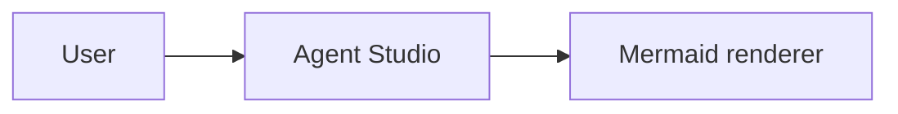

# Mermaid Chat Toggle Implementation Plan

> **For agentic workers:** REQUIRED SUB-SKILL: Use superpowers:subagent-driven-development (recommended) or superpowers:executing-plans to implement this plan task-by-task. Steps use checkbox (`- [ ]`) syntax for tracking.

**Goal:** Render Mermaid fenced code blocks inline in chat messages and Markdown file previews, with a header toggle between diagram and source views.

**Architecture:** Use Streamdown's `plugins.renderers` hook to route `language: "mermaid"` code fences into a shared `MarkdownMermaidBlock` component. The component owns diagram/source state, renders SVG through the already-installed `@streamdown/mermaid` plugin instance, and reuses the project's existing `CodeBlock` for the source view; chat and Markdown preview import one shared Streamdown plugin configuration.

**Tech Stack:** React 19, TypeScript, Streamdown 2.5, `@streamdown/mermaid`, `@streamdown/cjk`, `@streamdown/code`, `@streamdown/math`, Bun test, Testing Library, Tailwind v4 utilities backed by Agent Studio design tokens.

---

## File Structure

- Create `src/shared/markdown/MarkdownMermaidBlock.tsx`: shared Mermaid renderer with diagram/source segmented header, SVG rendering, incomplete fallback, and error fallback.
- Create `src/shared/markdown/streamdownPlugins.tsx`: shared Streamdown plugin object containing cjk/code/math/mermaid plus the Mermaid custom renderer.
- Modify `src/shared/markdown/MarkdownView.tsx`: remove local plugin assembly and import `STREAMDOWN_PLUGINS`.
- Modify `src/features/task/ChatStream.tsx`: pass `plugins={STREAMDOWN_PLUGINS}` to the existing streaming `Streamdown`.
- Modify `src/components/ai-elements/message.tsx`: replace local plugin object with `STREAMDOWN_PLUGINS` so `MessageResponse` also receives the custom Mermaid renderer.
- Modify `src/components/ai-elements/reasoning.tsx`: replace local plugin object with `STREAMDOWN_PLUGINS` for consistency in reasoning markdown.
- Create `src/shared/markdown/MarkdownMermaidBlock.test.tsx`: focused behavior tests for the new renderer and shared Streamdown wiring.

## Implementation Notes

- Do not import `streamdown/mermaid`; `streamdown` does not export that subpath in `package.json`.
- Use `mermaid.getMermaid()` from `@streamdown/mermaid` to render SVG in `MarkdownMermaidBlock`.
- Keep visual styling on token-backed utilities already used by this app: `bg-background`, `bg-card`, `bg-muted`, `text-foreground`, `text-muted-foreground`, `border-border`, `bg-primary`, `text-primary-foreground`, `rounded-md`.
- Do not add raw hex colors, raw HSL values, new design tokens, or a new UI dependency.
- Keep ordinary code fences on the existing `MarkdownCodeBlock` path.
- Streaming incomplete Mermaid fences should not call Mermaid render; source text stays available while the model is still writing.
- `CodeBlock` expects `language: BundledLanguage`; use `"mermaid"` for the source view because Shiki supports it in this dependency set. If TypeScript complains, narrow through a local constant typed as `BundledLanguage`.

## Task 1: Failing Tests For Mermaid Renderer

**Files:**
- Create: `src/shared/markdown/MarkdownMermaidBlock.test.tsx`

- [ ] **Step 1: Write the failing tests**

Create `src/shared/markdown/MarkdownMermaidBlock.test.tsx` with:

```tsx
import { afterEach, describe, expect, it, mock } from "bun:test";
import { cleanup, fireEvent, render, screen, waitFor } from "@testing-library/react";

mock.module("@streamdown/mermaid", () => ({
  mermaid: {
    getMermaid: () => ({
      render: async (_id: string, source: string) => ({
        svg: `<svg role="img" data-testid="mock-mermaid-svg"><text>${source}</text></svg>`,
      }),
    }),
  },
}));

const { Streamdown } = require("streamdown") as typeof import("streamdown");
const { STREAMDOWN_COMPONENTS } = require("./MarkdownCodeBlock") as typeof import("./MarkdownCodeBlock");
const { MarkdownMermaidBlock } = require("./MarkdownMermaidBlock") as typeof import("./MarkdownMermaidBlock");
const { STREAMDOWN_PLUGINS } = require("./streamdownPlugins") as typeof import("./streamdownPlugins");

afterEach(() => cleanup());

describe("MarkdownMermaidBlock", () => {
  it("renders diagram view by default", async () => {
    render(
      <MarkdownMermaidBlock
        code={"flowchart LR\\n  A --> B"}
        isIncomplete={false}
        language="mermaid"
      />
    );

    expect(screen.getByRole("button", { name: "图表" }).getAttribute("aria-pressed")).toBe("true");
    expect(screen.getByRole("button", { name: "源码" }).getAttribute("aria-pressed")).toBe("false");
    await waitFor(() => expect(screen.getByTestId("mock-mermaid-svg")).toBeDefined());
  });

  it("switches to source view and shows the original Mermaid code", async () => {
    render(
      <MarkdownMermaidBlock
        code={"sequenceDiagram\\n  Alice->>Bob: Hi"}
        isIncomplete={false}
        language="mermaid"
      />
    );

    fireEvent.click(screen.getByRole("button", { name: "源码" }));

    expect(screen.getByRole("button", { name: "源码" }).getAttribute("aria-pressed")).toBe("true");
    expect(document.body.textContent).toContain("sequenceDiagram");
    expect(document.body.textContent).toContain("Alice->>Bob: Hi");
  });

  it("does not render a diagram while the Mermaid fence is incomplete", () => {
    render(
      <MarkdownMermaidBlock
        code={"flowchart LR\\n  A -->"}
        isIncomplete
        language="mermaid"
      />
    );

    expect(screen.queryByTestId("mock-mermaid-svg")).toBeNull();
    expect(screen.getByText("Mermaid 正在生成，源码可先查看。")).toBeDefined();
  });

  it("routes Mermaid fences through the shared Streamdown renderer", async () => {
    render(
      <Streamdown
        components={STREAMDOWN_COMPONENTS}
        plugins={STREAMDOWN_PLUGINS}
      >
        {"```mermaid\\nflowchart LR\\n  A --> B\\n```"}
      </Streamdown>
    );

    expect(screen.getByRole("button", { name: "图表" })).toBeDefined();
    await waitFor(() => expect(screen.getByTestId("mock-mermaid-svg")).toBeDefined());
  });

  it("keeps non-Mermaid code fences on the normal code block renderer", () => {
    render(
      <Streamdown
        components={STREAMDOWN_COMPONENTS}
        plugins={STREAMDOWN_PLUGINS}
      >
        {"```typescript\\nconst ok = true;\\n```"}
      </Streamdown>
    );

    expect(screen.queryByRole("button", { name: "图表" })).toBeNull();
    expect(screen.getByText("typescript")).toBeDefined();
    expect(document.body.textContent).toContain("const ok = true;");
  });
});
```

- [ ] **Step 2: Run tests and verify the expected failure**

Run:

```bash
bun test src/shared/markdown/MarkdownMermaidBlock.test.tsx
```

Expected: FAIL because `MarkdownMermaidBlock` and `streamdownPlugins` do not exist yet.

## Task 2: Minimal Mermaid Toggle Component

**Files:**
- Create: `src/shared/markdown/MarkdownMermaidBlock.tsx`

- [ ] **Step 1: Implement the component**

Create `src/shared/markdown/MarkdownMermaidBlock.tsx` with:

```tsx
// Mermaid renderer for Streamdown custom code-fence renderers.
//
// Chat and Markdown preview both use this component. It deliberately owns the
// diagram/source switch here, instead of parsing Markdown upstream, so
// streaming code-fence state can flow through Streamdown unchanged.

import { useEffect, useMemo, useState, type ReactNode } from "react";
import type { BundledLanguage } from "shiki";
import type { CustomRendererProps } from "streamdown";
import { mermaid as mermaidPlugin } from "@streamdown/mermaid";
import { cn } from "@/lib/utils";
import {
  CodeBlock,
  CodeBlockActions,
  CodeBlockCopyButton,
  CodeBlockFilename,
  CodeBlockHeader,
  CodeBlockTitle,
} from "@/components/ai-elements/code-block";

type MermaidViewMode = "diagram" | "source";

const MERMAID_LANGUAGE = "mermaid" as BundledLanguage;

function createMermaidId(code: string): string {
  let hash = 0;
  for (const char of code) {
    hash = (Math.imul(31, hash) + char.charCodeAt(0)) | 0;
  }
  return `agent-studio-mermaid-${Math.abs(hash)}-${Date.now().toString(36)}`;
}

function MermaidToggleButton({
  active,
  children,
  onClick,
}: {
  active: boolean;
  children: ReactNode;
  onClick: () => void;
}) {
  return (
    <button
      aria-pressed={active}
      className={cn(
        "h-7 rounded-sm px-2 text-xs transition-colors",
        active
          ? "bg-primary text-primary-foreground"
          : "text-muted-foreground hover:bg-muted hover:text-foreground"
      )}
      onClick={onClick}
      type="button"
    >
      {children}
    </button>
  );
}

export function MarkdownMermaidBlock({
  code,
  isIncomplete,
}: CustomRendererProps) {
  const [mode, setMode] = useState<MermaidViewMode>("diagram");
  const [svg, setSvg] = useState<string | null>(null);
  const [error, setError] = useState<string | null>(null);

  const trimmedCode = useMemo(() => code.replace(/\n$/, ""), [code]);

  useEffect(() => {
    let cancelled = false;

    if (isIncomplete || trimmedCode.trim().length === 0) {
      setSvg(null);
      setError(null);
      return;
    }

    setSvg(null);
    setError(null);

    const renderer = mermaidPlugin.getMermaid();
    const id = createMermaidId(trimmedCode);

    void renderer
      .render(id, trimmedCode)
      .then(({ svg: nextSvg }) => {
        if (!cancelled) {
          setSvg(nextSvg);
        }
      })
      .catch((renderError: unknown) => {
        if (!cancelled) {
          setError(renderError instanceof Error ? renderError.message : "Mermaid render failed");
        }
      });

    return () => {
      cancelled = true;
    };
  }, [isIncomplete, trimmedCode]);

  const showSource = mode === "source";

  return (
    <div
      className="my-3 w-full overflow-hidden rounded-md border border-border bg-background text-foreground"
      data-language="mermaid"
    >
      <div className="flex items-center justify-between gap-3 border-b border-border bg-muted/80 px-3 py-2">
        <div className="font-mono text-muted-foreground text-xs">Mermaid</div>
        <div className="flex shrink-0 items-center gap-1 rounded-md border border-border bg-background p-0.5">
          <MermaidToggleButton active={!showSource} onClick={() => setMode("diagram")}>
            图表
          </MermaidToggleButton>
          <MermaidToggleButton active={showSource} onClick={() => setMode("source")}>
            源码
          </MermaidToggleButton>
        </div>
      </div>

      {showSource ? (
        <CodeBlock
          className="my-0 rounded-none border-0"
          code={trimmedCode}
          language={MERMAID_LANGUAGE}
        >
          <CodeBlockHeader>
            <CodeBlockTitle>
              <CodeBlockFilename>mermaid</CodeBlockFilename>
            </CodeBlockTitle>
            <CodeBlockActions>
              <CodeBlockCopyButton />
            </CodeBlockActions>
          </CodeBlockHeader>
        </CodeBlock>
      ) : (
        <div className="min-h-32 overflow-auto bg-background p-4">
          {isIncomplete ? (
            <p className="m-0 text-muted-foreground text-sm">
              Mermaid 正在生成，源码可先查看。
            </p>
          ) : error ? (
            <div className="space-y-2">
              <p className="m-0 font-medium text-foreground text-sm">
                Mermaid 图表渲染失败。
              </p>
              <p className="m-0 text-muted-foreground text-xs">{error}</p>
            </div>
          ) : svg ? (
            <div
              className="flex justify-center [&_svg]:h-auto [&_svg]:max-w-full"
              dangerouslySetInnerHTML={{ __html: svg }}
            />
          ) : (
            <p className="m-0 text-muted-foreground text-sm">正在渲染 Mermaid 图表…</p>
          )}
        </div>
      )}
    </div>
  );
}
```

- [ ] **Step 2: Run the focused test and verify partial failure**

Run:

```bash
bun test src/shared/markdown/MarkdownMermaidBlock.test.tsx
```

Expected: still FAIL because `streamdownPlugins.tsx` does not exist yet. Tests that import only `MarkdownMermaidBlock` may now pass once the module resolves.

## Task 3: Shared Streamdown Plugin Configuration

**Files:**
- Create: `src/shared/markdown/streamdownPlugins.tsx`
- Modify: `src/shared/markdown/MarkdownView.tsx`
- Modify: `src/features/task/ChatStream.tsx`

- [ ] **Step 1: Create shared plugins**

Create `src/shared/markdown/streamdownPlugins.tsx` with:

```tsx
// Shared Streamdown plugin setup for every Markdown surface that should match
// chat behavior: CJK punctuation, code highlighting, math, Mermaid, and the
// project-specific Mermaid diagram/source renderer.

import { cjk } from "@streamdown/cjk";
import { code } from "@streamdown/code";
import { math } from "@streamdown/math";
import { mermaid } from "@streamdown/mermaid";
import type { PluginConfig } from "streamdown";
import { MarkdownMermaidBlock } from "./MarkdownMermaidBlock";

export const STREAMDOWN_PLUGINS: PluginConfig = {
  cjk,
  code,
  math,
  mermaid,
  renderers: [
    {
      component: MarkdownMermaidBlock,
      language: "mermaid",
    },
  ],
};
```

- [ ] **Step 2: Update MarkdownView**

In `src/shared/markdown/MarkdownView.tsx`, remove these imports:

```tsx
import { cjk } from "@streamdown/cjk";
import { code } from "@streamdown/code";
import { math } from "@streamdown/math";
import { mermaid } from "@streamdown/mermaid";
```

Remove this local constant:

```tsx
const STREAMDOWN_PLUGINS = { cjk, code, math, mermaid };
```

Add this import:

```tsx
import { STREAMDOWN_PLUGINS } from "./streamdownPlugins";
```

Keep the existing render line:

```tsx
<Streamdown plugins={STREAMDOWN_PLUGINS} components={STREAMDOWN_COMPONENTS}>
  {body}
</Streamdown>
```

- [ ] **Step 3: Update ChatStream**

In `src/features/task/ChatStream.tsx`, add:

```tsx
import { STREAMDOWN_PLUGINS } from "@/shared/markdown/streamdownPlugins";
```

Then update the streaming `Streamdown` inside assistant text rendering:

```tsx
<Streamdown
  mode="streaming"
  parseIncompleteMarkdown
  components={STREAMDOWN_COMPONENTS}
  plugins={STREAMDOWN_PLUGINS}
>
  {b.content}
</Streamdown>
```

- [ ] **Step 4: Run focused tests and verify green**

Run:

```bash
bun test src/shared/markdown/MarkdownMermaidBlock.test.tsx
```

Expected: PASS.

## Task 4: Wire Remaining AI Markdown Surfaces

**Files:**
- Modify: `src/components/ai-elements/message.tsx`
- Modify: `src/components/ai-elements/reasoning.tsx`

- [ ] **Step 1: Update MessageResponse plugin import**

In `src/components/ai-elements/message.tsx`, remove:

```tsx
import { cjk } from "@streamdown/cjk";
import { code } from "@streamdown/code";
import { math } from "@streamdown/math";
import { mermaid } from "@streamdown/mermaid";
```

Add:

```tsx
import { STREAMDOWN_PLUGINS } from "@/shared/markdown/streamdownPlugins";
```

Remove:

```tsx
const streamdownPlugins = { cjk, code, math, mermaid };
```

Change `MessageResponse` to:

```tsx
export const MessageResponse = memo(
  ({ className, ...props }: MessageResponseProps) => (
    <Streamdown
      className={cn(
        "size-full [&>*:first-child]:mt-0 [&>*:last-child]:mb-0",
        className
      )}
      plugins={STREAMDOWN_PLUGINS}
      {...props}
    />
  ),
  (prevProps, nextProps) =>
    prevProps.children === nextProps.children &&
    nextProps.isAnimating === prevProps.isAnimating
);
```

- [ ] **Step 2: Update reasoning plugin import**

In `src/components/ai-elements/reasoning.tsx`, remove:

```tsx
import { cjk } from "@streamdown/cjk";
import { code } from "@streamdown/code";
import { math } from "@streamdown/math";
import { mermaid } from "@streamdown/mermaid";
```

Add:

```tsx
import { STREAMDOWN_PLUGINS } from "@/shared/markdown/streamdownPlugins";
```

Remove:

```tsx
const streamdownPlugins = { cjk, code, math, mermaid };
```

Change the reasoning `Streamdown` render to:

```tsx
<Streamdown plugins={STREAMDOWN_PLUGINS}>{children}</Streamdown>
```

- [ ] **Step 3: Run focused tests again**

Run:

```bash
bun test src/shared/markdown/MarkdownMermaidBlock.test.tsx
```

Expected: PASS.

## Task 5: Typecheck And Build Verification

**Files:**
- Verify all modified frontend files.

- [ ] **Step 1: Run TypeScript typecheck**

Run:

```bash
bunx tsc --noEmit -p tsconfig.app.json
```

Expected: PASS.

If TypeScript reports that `mermaid` is not a valid `BundledLanguage`, keep `MERMAID_LANGUAGE` local and change its definition in `MarkdownMermaidBlock.tsx` to:

```tsx
const MERMAID_LANGUAGE = "mermaid" as unknown as BundledLanguage;
```

Then rerun the same typecheck.

- [ ] **Step 2: Run production build**

Run:

```bash
bun run build
```

Expected: PASS.

## Task 6: Browser Smoke Test

**Files:**
- Verify local Vite app.

- [ ] **Step 1: Start the frontend dev server**

Run:

```bash
bun run dev
```

Expected: Vite starts on `http://localhost:1420`.

- [ ] **Step 2: Open the local app in the in-app browser**

Navigate Browser to:

```text
http://localhost:1420
```

Expected: Agent Studio loads.

- [ ] **Step 3: Smoke test with a Mermaid Markdown sample**

Use whichever existing route or story surface is fastest in the running app to render this Markdown text:

```markdown

```

Expected:

- The Mermaid block shows `Mermaid` in the header.
- The default view is `图表`.
- Clicking `源码` shows the original Mermaid source.
- Clicking `图表` returns to the rendered diagram.
- A non-Mermaid code fence still renders as a normal project `CodeBlock`.

## Task 7: Commit

**Files:**
- Stage all feature files and docs.

- [ ] **Step 1: Check status**

Run:

```bash
git status --short
```

Expected: only the Mermaid docs, new shared Markdown files, and updated Streamdown callsites are changed.

- [ ] **Step 2: Stage changes**

Run:

```bash
git add docs/superpowers/specs/2026-06-07-mermaid-chat-toggle-design.md \
  docs/superpowers/plans/2026-06-07-mermaid-chat-toggle.md \
  src/shared/markdown/MarkdownMermaidBlock.tsx \
  src/shared/markdown/MarkdownMermaidBlock.test.tsx \
  src/shared/markdown/streamdownPlugins.tsx \
  src/shared/markdown/MarkdownView.tsx \
  src/features/task/ChatStream.tsx \
  src/components/ai-elements/message.tsx \
  src/components/ai-elements/reasoning.tsx
```

- [ ] **Step 3: Commit**

Run:

```bash
git commit -m "feat(markdown): add mermaid diagram source toggle"
```

Expected: commit succeeds.

## Self-Review

- Spec coverage: chat rendering, Markdown preview rendering, diagram/source switch, streaming incomplete fallback, error fallback, and non-Mermaid code preservation all map to tasks.
- Placeholder scan: no `TBD`, `TODO`, or "implement later" placeholders remain.
- Type consistency: `MarkdownMermaidBlock`, `STREAMDOWN_PLUGINS`, `STREAMDOWN_COMPONENTS`, and `CustomRendererProps` names match across tasks.
- Scope check: this is one frontend Markdown rendering subsystem; no sidecar/runtime protocol work is included.
