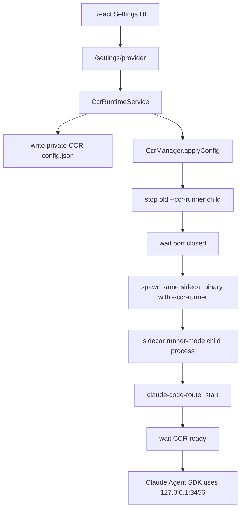

# CCR Child Process Runtime Implementation Plan

> **For agentic workers:** REQUIRED SUB-SKILL: Use superpowers:subagent-driven-development (recommended) or superpowers:executing-plans to implement this plan task-by-task. Steps use checkbox (`- [ ]`) syntax for tracking.

**Goal:** 将 Agent Studio 内置 CCR 从 Bun Worker 托管改为独立 OS 子进程托管，同时保持单个 Bun compiled sidecar 二进制，避免打包两份 Bun runtime。

**Architecture:** 保留现有 `CcrRuntimeService` 的“provider settings 生成完整 CCR 路由集合”设计，只替换底层 CCR 生命周期管理。主 sidecar 仍由 `agent-studio-sidecar-*` 启动 HTTP 服务；需要启动 CCR 时，主 sidecar 用 `Bun.spawn([process.execPath, "--ccr-runner", ...])` 再启动同一个二进制的 runner 模式。runner 模式内加载私有 CCR CLI 资产并执行 `start`，因此 CCR pid file 指向独立子进程 pid，而不是主 sidecar pid。

**Tech Stack:** Bun compiled single sidecar binary, Tauri externalBin, `@musistudio/claude-code-router`, Hono sidecar routes, Bun test, TypeScript.

---

## 背景与根因

当前错误：

```text
CCR 启动失败：ccr_port_still_open:ccr_port_close_probe_timeout
[ccr] refresh after provider settings change failed: warn: ccr_port_still_open:ccr_port_close_probe_timeout
```

现场证据显示当前 CCR pid file 指向主 sidecar：

```bash
cat "/Users/wisen/Library/Application Support/com.AgentStudioLab.agent-studio/ccr/.claude-code-router/.claude-code-router.pid"
# 76140

ps -p 76140 -o pid,ppid,comm,args
# 76140 ... agent-studio-sidecar --port=...

lsof -nP -iTCP:3456 -sTCP:LISTEN
# agent-stu 76140 ... TCP 127.0.0.1:3456 (LISTEN)
```

CCR 官方 README 明确写明：修改 `config.json` 后需要 `ccr restart` 才生效。CCR CLI 源码生命周期基于 pid file：

- `start`: 如果 `PID_FILE` 对应 pid 存活，直接输出 `claude-code-router server is running` 并返回。
- `start`: 真正启动时写入 `PID_FILE = process.pid`。
- `stop/restart`: 读取 `PID_FILE`，对该 pid 执行 `process.kill(pid)`。

当前 Agent Studio 把 CCR 放进 `new Worker(...)`，Worker 内 `process.pid` 仍是主 sidecar 进程 pid。这导致：

- CCR pid file 指向主 sidecar。
- 官方 `stop/restart` 语义不能使用，否则会杀主 sidecar。
- `worker.terminate()` 和 CCR 官方进程生命周期不等价。
- 端口释放不可控，出现 `ccr_port_still_open:*`。

所以本计划不再继续调整 timeout，而是修复进程边界。

## 目标行为



运行时要求：

- 修改 OpenAI-compatible provider/model 后，主 sidecar 写完整 CCR config。
- 只有 config signature 变化或 CCR 不健康时才重启 CCR runner。
- CCR pid file 指向独立 `--ccr-runner` 子进程 pid。
- 旧 Worker 模式残留 pid 指向主 sidecar 时，只删除 stale pid file，不 kill 主 sidecar。
- 旧 CCR runner 残留 pid 指向其他存活进程时，先 kill 旧 runner-mode 子进程，再启动新 runner。
- 如果 3456 端口被非 CCR/非当前管理进程占用，明确报错并展示 pid/command。
- 官方服务继续 out of scope，不改它是否走 CCR。
- 打包产物仍只有 `agent-studio-sidecar-*`，不新增第二个 Bun runtime。

## 文件结构

### 创建

- `sidecar/src/ccr/process.ts`
  - 封装 pid file 读取、判断 pid 是否存活、kill pid、端口监听诊断。

- `sidecar/src/ccr/process.test.ts`
  - 覆盖 stale pid、当前 pid、其他 pid、pid file 清理。

- `sidecar/src/ccr/runner-mode.ts`
  - 封装同二进制 runner 模式入口。
  - 解析 `--ccr-runner --config-dir <dir> --cli <path>`。
  - 设置私有 HOME 后加载 CCR CLI 并执行 `start`。

- `sidecar/src/ccr/runner-mode.test.ts`
  - 覆盖 runner mode 参数解析和环境注入。

### 修改

- `sidecar/src/server.ts`
  - 在打开 DB、初始化服务前检查 `--ccr-runner`。
  - runner 模式直接进入 CCR CLI，不启动 HTTP sidecar。

- `sidecar/src/ccr/spawn.ts`
  - 删除 Worker 托管。
  - 改为 spawn 当前 sidecar 二进制的 `--ccr-runner` 模式。
  - 保留 `prepareManagedCcrConfig()` 和 CCR runtime asset 复制。
  - 暴露 child pid。

- `sidecar/src/ccr/spawn.test.ts`
  - 删除 Worker 断言。
  - 新增同二进制 runner-mode spawn 参数、env、pid、stop 语义测试。

- `sidecar/src/ccr/manager.ts`
  - 保持 apply queue、phase、routeKeys。
  - stop/start 使用真实 child process handle。
  - 错误信息合并端口占用诊断。

- `sidecar/src/ccr/health.ts`
  - 保留 `waitForPortClosed`、`waitForCcrReady`。
  - 允许传入 `describeOwner`，总体超时错误附加 owner 信息。

- `scripts/build-sidecar.ts`
  - 原则上不新增第二 entry；仍只编译 `sidecar/src/server.ts`。
  - 只有当 single-binary runner mode 编译失败时才调整入口结构，但输出仍必须是单个 `agent-studio-sidecar-*`。

- `src-tauri/tauri.conf.json`
  - 保持 `externalBin: ["binaries/agent-studio-sidecar"]`。
  - 不新增 runner externalBin。

## 任务拆解

### Task 1: 新增 CCR 进程诊断工具

**Files:**

- Create: `sidecar/src/ccr/process.ts`
- Create: `sidecar/src/ccr/process.test.ts`
- Modify: `sidecar/src/ccr/index.ts`

- [ ] **Step 1: 写 failing test**

创建 `sidecar/src/ccr/process.test.ts`：

```ts
import { mkdtemp, rm } from "node:fs/promises";
import os from "node:os";
import path from "node:path";
import { describe, expect, it, mock } from "bun:test";
import {
  ccrPrivatePidPath,
  readPidFile,
  stopPidFromFile,
} from "./process";

describe("CCR process helpers", () => {
  it("reads numeric private pid files", async () => {
    const dir = await mkdtemp(path.join(os.tmpdir(), "agent-studio-ccr-"));
    try {
      await Bun.write(ccrPrivatePidPath(dir), "12345\n");
      expect(await readPidFile(dir)).toBe(12345);
    } finally {
      await rm(dir, { recursive: true, force: true });
    }
  });

  it("removes invalid pid files", async () => {
    const dir = await mkdtemp(path.join(os.tmpdir(), "agent-studio-ccr-"));
    try {
      await Bun.write(ccrPrivatePidPath(dir), "not-a-pid");
      expect(await readPidFile(dir)).toBeNull();
      expect(await Bun.file(ccrPrivatePidPath(dir)).exists()).toBe(false);
    } finally {
      await rm(dir, { recursive: true, force: true });
    }
  });

  it("does not kill the current process when stale Worker pid points at sidecar", async () => {
    const dir = await mkdtemp(path.join(os.tmpdir(), "agent-studio-ccr-"));
    const killPid = mock(async () => {});
    try {
      await Bun.write(ccrPrivatePidPath(dir), `${process.pid}\n`);
      const result = await stopPidFromFile(dir, {
        currentPid: process.pid,
        killPid,
        isPidAlive: async () => true,
      });
      expect(result).toEqual({ stopped: false, reason: "pid_is_current_process" });
      expect(killPid).not.toHaveBeenCalled();
      expect(await Bun.file(ccrPrivatePidPath(dir)).exists()).toBe(false);
    } finally {
      await rm(dir, { recursive: true, force: true });
    }
  });

  it("kills a live external CCR runner pid and removes pid file", async () => {
    const dir = await mkdtemp(path.join(os.tmpdir(), "agent-studio-ccr-"));
    const killed: number[] = [];
    try {
      await Bun.write(ccrPrivatePidPath(dir), "4242\n");
      const result = await stopPidFromFile(dir, {
        currentPid: 111,
        isPidAlive: async (pid) => pid === 4242,
        killPid: async (pid) => {
          killed.push(pid);
        },
      });
      expect(result).toEqual({ stopped: true, pid: 4242 });
      expect(killed).toEqual([4242]);
      expect(await Bun.file(ccrPrivatePidPath(dir)).exists()).toBe(false);
    } finally {
      await rm(dir, { recursive: true, force: true });
    }
  });
});
```

- [ ] **Step 2: 运行 test 确认失败**

```bash
cd /Users/wisen/project/personal/agent-works/sidecar
bun test src/ccr/process.test.ts
```

Expected: FAIL，提示 `Cannot find module './process'`。

- [ ] **Step 3: 实现 `process.ts`**

创建 `sidecar/src/ccr/process.ts`：

```ts
import { readFile, rm } from "node:fs/promises";
import path from "node:path";

export function ccrPrivatePidPath(configDir: string): string {
  return path.join(configDir, ".claude-code-router", ".claude-code-router.pid");
}

export async function removePidFile(configDir: string): Promise<void> {
  await rm(ccrPrivatePidPath(configDir), { force: true });
}

export async function readPidFile(configDir: string): Promise<number | null> {
  const pidPath = ccrPrivatePidPath(configDir);
  try {
    const raw = await readFile(pidPath, "utf8");
    const pid = Number.parseInt(raw.trim(), 10);
    if (Number.isFinite(pid) && pid > 0) return pid;
  } catch {
    return null;
  }
  await removePidFile(configDir);
  return null;
}

export interface StopPidFromFileOptions {
  currentPid?: number;
  isPidAlive?: (pid: number) => Promise<boolean>;
  killPid?: (pid: number, signal?: NodeJS.Signals) => Promise<void>;
}

export type StopPidFromFileResult =
  | { stopped: true; pid: number }
  | { stopped: false; reason: "no_pid" | "pid_not_alive" | "pid_is_current_process" };

async function defaultIsPidAlive(pid: number): Promise<boolean> {
  try {
    process.kill(pid, 0);
    return true;
  } catch {
    return false;
  }
}

async function defaultKillPid(pid: number, signal: NodeJS.Signals = "SIGTERM"): Promise<void> {
  process.kill(pid, signal);
}

export async function stopPidFromFile(
  configDir: string,
  options: StopPidFromFileOptions = {},
): Promise<StopPidFromFileResult> {
  const pid = await readPidFile(configDir);
  if (!pid) return { stopped: false, reason: "no_pid" };

  const currentPid = options.currentPid ?? process.pid;
  if (pid === currentPid) {
    await removePidFile(configDir);
    return { stopped: false, reason: "pid_is_current_process" };
  }

  const isPidAlive = options.isPidAlive ?? defaultIsPidAlive;
  if (!(await isPidAlive(pid))) {
    await removePidFile(configDir);
    return { stopped: false, reason: "pid_not_alive" };
  }

  await (options.killPid ?? defaultKillPid)(pid, "SIGTERM");
  await removePidFile(configDir);
  return { stopped: true, pid };
}
```

修改 `sidecar/src/ccr/index.ts`：

```ts
export * from "./process";
```

- [ ] **Step 4: 运行 test 确认通过**

```bash
cd /Users/wisen/project/personal/agent-works/sidecar
bun test src/ccr/process.test.ts
```

Expected: PASS。

### Task 2: 新增同二进制 CCR runner 模式

**Files:**

- Create: `sidecar/src/ccr/runner-mode.ts`
- Create: `sidecar/src/ccr/runner-mode.test.ts`
- Modify: `sidecar/src/server.ts`

- [ ] **Step 1: 写 failing test**

创建 `sidecar/src/ccr/runner-mode.test.ts`：

```ts
import { describe, expect, it } from "bun:test";
import {
  buildCcrRunnerProcessArgv,
  isCcrRunnerMode,
  parseCcrRunnerArgs,
} from "./runner-mode";

describe("CCR runner mode", () => {
  it("detects runner mode", () => {
    expect(isCcrRunnerMode(["--ccr-runner", "--config-dir", "/tmp/ccr"])).toBe(true);
    expect(isCcrRunnerMode(["--port=1234"])).toBe(false);
  });

  it("parses runner args", () => {
    expect(
      parseCcrRunnerArgs([
        "--ccr-runner",
        "--config-dir",
        "/tmp/ccr",
        "--cli",
        "/tmp/ccr/runtime/ccr-cli.js",
      ]),
    ).toEqual({
      configDir: "/tmp/ccr",
      cliPath: "/tmp/ccr/runtime/ccr-cli.js",
    });
  });

  it("builds CCR CLI argv for start mode", () => {
    expect(buildCcrRunnerProcessArgv("/tmp/ccr/runtime/ccr-cli.js")).toEqual([
      process.argv[0],
      "/tmp/ccr/runtime/ccr-cli.js",
      "start",
    ]);
  });
});
```

- [ ] **Step 2: 运行 test 确认失败**

```bash
cd /Users/wisen/project/personal/agent-works/sidecar
bun test src/ccr/runner-mode.test.ts
```

Expected: FAIL，提示 `Cannot find module './runner-mode'`。

- [ ] **Step 3: 实现 `runner-mode.ts`**

创建 `sidecar/src/ccr/runner-mode.ts`：

```ts
import os from "node:os";
import path from "node:path";

export interface CcrRunnerArgs {
  configDir: string;
  cliPath: string;
}

function readArg(argv: string[], name: string): string | null {
  const index = argv.indexOf(name);
  if (index === -1) return null;
  return argv[index + 1] ?? null;
}

export function isCcrRunnerMode(argv: string[]): boolean {
  return argv.includes("--ccr-runner");
}

export function parseCcrRunnerArgs(argv: string[]): CcrRunnerArgs {
  const configDir = readArg(argv, "--config-dir");
  const cliPath = readArg(argv, "--cli");
  if (!configDir) throw new Error("ccr_runner_config_dir_missing");
  if (!cliPath) throw new Error("ccr_runner_cli_missing");
  return { configDir, cliPath };
}

export function buildCcrRunnerProcessArgv(cliPath: string): string[] {
  return [process.argv[0], cliPath, "start"];
}

export function runCcrRunnerMode(argv: string[]): void {
  const { configDir, cliPath } = parseCcrRunnerArgs(argv);

  process.env.HOME = configDir;
  process.env.USERPROFILE = configDir;
  process.env.CCR_PRIVATE_HOME = configDir;
  process.env.CI = "true";
  process.env.FORCE_COLOR = "0";

  os.homedir = () => configDir;
  process.argv = buildCcrRunnerProcessArgv(cliPath);
  require(path.resolve(cliPath));
}
```

- [ ] **Step 4: 接入 `server.ts`**

在 `sidecar/src/server.ts` 顶部 imports 增加：

```ts
import { isCcrRunnerMode, runCcrRunnerMode } from "./ccr/runner-mode";
```

在任何 DB 初始化、服务初始化前加入：

```ts
if (isCcrRunnerMode(process.argv.slice(2))) {
  runCcrRunnerMode(process.argv.slice(2));
  await new Promise(() => {});
}
```

注意：这必须在 `parseArgs()` 和 `openDb()` 前面，否则 runner 子进程会因为缺少 `--port/--token/--db` 退出。

- [ ] **Step 5: 运行 test 确认通过**

```bash
cd /Users/wisen/project/personal/agent-works/sidecar
bun test src/ccr/runner-mode.test.ts
```

Expected: PASS。

### Task 3: 将 spawn 从 Worker 改为同二进制 child process

**Files:**

- Modify: `sidecar/src/ccr/spawn.ts`
- Modify: `sidecar/src/ccr/spawn.test.ts`

- [ ] **Step 1: 写 failing test**

在 `sidecar/src/ccr/spawn.test.ts` 增加：

```ts
it("starts CCR through the same sidecar binary runner mode", async () => {
  const dir = await mkdtemp(path.join(os.tmpdir(), "agent-studio-ccr-"));
  const calls: unknown[] = [];
  try {
    const handle = await spawnManagedCcr(
      { port: 4567, configDir: dir, config: config() },
      {
        sidecarPath: "/private/agent-studio-sidecar",
        cliPath: "/private/ccr/runtime/ccr-cli.js",
        spawnProcess: async (command, args, options) => {
          calls.push({ command, args, options });
          return {
            pid: 4242,
            exited: Promise.resolve(0),
            kill: () => true,
          };
        },
      },
    );

    expect(handle.pid).toBe(4242);
    expect(calls).toEqual([
      {
        command: "/private/agent-studio-sidecar",
        args: [
          "--ccr-runner",
          "--config-dir",
          dir,
          "--cli",
          "/private/ccr/runtime/ccr-cli.js",
          "--port",
          "4567",
        ],
        options: expect.objectContaining({
          env: expect.objectContaining({
            HOME: dir,
            USERPROFILE: dir,
            CCR_PRIVATE_HOME: dir,
            CI: "true",
            FORCE_COLOR: "0",
          }),
        }),
      },
    ]);

    await handle.stop();
  } finally {
    await rm(dir, { recursive: true, force: true });
  }
});
```

- [ ] **Step 2: 运行 test 确认失败**

```bash
cd /Users/wisen/project/personal/agent-works/sidecar
bun test src/ccr/spawn.test.ts
```

Expected: FAIL，`sidecarPath` 或 `spawnProcess` 选项不存在。

- [ ] **Step 3: 实现 child process spawn**

在 `sidecar/src/ccr/spawn.ts` 替换 Worker 类型：

```ts
interface CcrChildProcessLike {
  pid?: number;
  exited: Promise<number>;
  kill: (signal?: NodeJS.Signals) => boolean;
}

type CcrProcessSpawner = (
  command: string,
  args: string[],
  options: {
    env: Record<string, string>;
    stdout: "inherit" | "pipe" | "ignore";
    stderr: "inherit" | "pipe" | "ignore";
  },
) => Promise<CcrChildProcessLike>;

function defaultSidecarPath(): string {
  return process.env.AGENT_STUDIO_SIDECAR_PATH ?? process.execPath;
}

async function defaultSpawnProcess(
  command: string,
  args: string[],
  options: Parameters<CcrProcessSpawner>[2],
): Promise<CcrChildProcessLike> {
  const proc = Bun.spawn([command, ...args], options);
  return {
    pid: proc.pid,
    exited: proc.exited,
    kill: (signal) => proc.kill(signal),
  };
}
```

`spawnManagedCcr()` 改为：

```ts
export async function spawnManagedCcr(
  input: CcrSpawnInput,
  options: {
    cliPath?: string;
    sidecarPath?: string;
    spawnProcess?: CcrProcessSpawner;
  } = {},
): Promise<CcrProcessHandle> {
  const runtimeAssets =
    options.cliPath === undefined
      ? await prepareCcrRuntimeAssets({ configDir: input.configDir })
      : {
          cliPath: options.cliPath,
          wasmPath: path.join(path.dirname(options.cliPath), "tiktoken_bg.wasm"),
        };

  const sidecarPath = options.sidecarPath ?? defaultSidecarPath();
  const home = ccrPrivateHome(input.configDir);
  const env = compactEnv({
    ...process.env,
    HOME: home,
    USERPROFILE: home,
    CCR_PRIVATE_HOME: home,
    CI: "true",
    FORCE_COLOR: "0",
  });

  const proc = await (options.spawnProcess ?? defaultSpawnProcess)(
    sidecarPath,
    [
      "--ccr-runner",
      "--config-dir",
      input.configDir,
      "--cli",
      runtimeAssets.cliPath,
      "--port",
      String(input.port),
    ],
    {
      env,
      stdout: "inherit",
      stderr: "inherit",
    },
  );

  return {
    pid: proc.pid,
    stop: async (signal = "SIGTERM") => {
      proc.kill(signal);
      await proc.exited.catch(() => {});
    },
  };
}
```

- [ ] **Step 4: 删除旧 Worker 测试**

删除或改写这些旧测试：

- `starts ccr in an isolated Worker instead of re-executing the sidecar binary`
- `removes stale CCR pid files before starting the isolated Worker`
- `waits for Worker termination when stopping CCR`

新增 stop 测试：

```ts
it("waits for child process exit when stopping CCR", async () => {
  const dir = await mkdtemp(path.join(os.tmpdir(), "agent-studio-ccr-"));
  let releaseExit: (() => void) | undefined;
  let killed = false;
  try {
    const handle = await spawnManagedCcr(
      { port: 4567, configDir: dir, config: config() },
      {
        sidecarPath: "/private/agent-studio-sidecar",
        cliPath: "/private/ccr/runtime/ccr-cli.js",
        spawnProcess: async () => ({
          pid: 4242,
          kill: () => {
            killed = true;
            releaseExit?.();
            return true;
          },
          exited: new Promise<number>((resolve) => {
            releaseExit = () => resolve(0);
          }),
        }),
      },
    );

    await handle.stop();
    expect(killed).toBe(true);
  } finally {
    await rm(dir, { recursive: true, force: true });
  }
});
```

- [ ] **Step 5: 运行 tests**

```bash
cd /Users/wisen/project/personal/agent-works/sidecar
bun test src/ccr/spawn.test.ts
```

Expected: PASS。

### Task 4: 启动前清理旧 pid file 与遗留进程

**Files:**

- Modify: `sidecar/src/ccr/spawn.ts`
- Modify: `sidecar/src/ccr/spawn.test.ts`

- [ ] **Step 1: 写 failing test：旧 Worker pid 指向当前进程时只删除 pid**

在 `spawn.test.ts` 增加：

```ts
it("removes stale Worker pid files without killing the current sidecar process", async () => {
  const dir = await mkdtemp(path.join(os.tmpdir(), "agent-studio-ccr-"));
  const killed: number[] = [];
  try {
    await Bun.write(ccrPrivatePidPath(dir), `${process.pid}\n`);

    await spawnManagedCcr(
      { port: 4567, configDir: dir, config: config() },
      {
        sidecarPath: "/private/agent-studio-sidecar",
        cliPath: "/private/ccr/runtime/ccr-cli.js",
        spawnProcess: async () => ({
          pid: 4242,
          kill: () => true,
          exited: Promise.resolve(0),
        }),
        stopExistingPid: async (pid) => {
          killed.push(pid);
        },
      },
    );

    expect(killed).toEqual([]);
    expect(await Bun.file(ccrPrivatePidPath(dir)).exists()).toBe(false);
  } finally {
    await rm(dir, { recursive: true, force: true });
  }
});
```

- [ ] **Step 2: 写 failing test：旧 runner pid 会被停止**

```ts
it("stops a previous runner-mode sidecar child before starting a new one", async () => {
  const dir = await mkdtemp(path.join(os.tmpdir(), "agent-studio-ccr-"));
  const stopped: number[] = [];
  try {
    await Bun.write(ccrPrivatePidPath(dir), "4241\n");

    await spawnManagedCcr(
      { port: 4567, configDir: dir, config: config() },
      {
        sidecarPath: "/private/agent-studio-sidecar",
        cliPath: "/private/ccr/runtime/ccr-cli.js",

### 为什么不用系统 node

Agent Studio 是桌面应用，不能假设用户机器安装了 node 或 bun。不新增第二个 compiled binary；同一个 `agent-studio-sidecar` 通过 `--ccr-runner` 参数进入 runner 模式，因此用户不需要 node/bun，也不会打包两份 Bun runtime。

### 为什么不直接调用 CCR 官方 restart

CCR 官方 `restart` 会 detach 一个新 node 进程，主 sidecar 无法可靠拿到子进程 handle、stdout/stderr 和 ready 状态。Agent Studio 需要 UI 展示 applying/ready/error，因此必须自己管理 child lifecycle。
