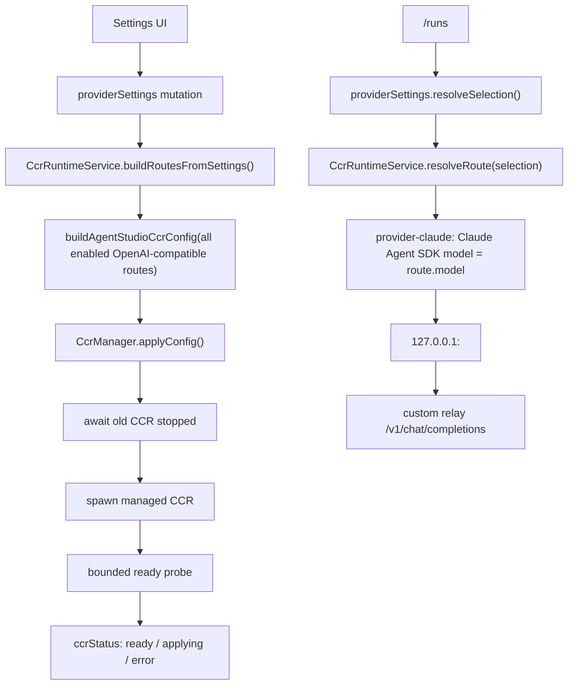

# CCR 设置期应用与运行期稳定路由实施计划

> **For agentic workers:** REQUIRED SUB-SKILL: Use `superpowers:subagent-driven-development`（推荐）or `superpowers:executing-plans` to implement this plan task-by-task. Steps use checkbox (`- [ ]`) syntax for tracking.

**Goal:** 修复自定义 OpenAI-compatible 中转站在切换模型/连接后对话卡住的问题，让 CCR 配置在设置期统一生成并重启应用，普通对话只选择已存在的稳定路由。

**Architecture:** 本计划把 CCR 从“每次 run 动态生成单 route 配置”的模式，改为“provider settings 变化时生成全量 enabled OpenAI-compatible route registry 并应用 CCR config”。`/runs` 不再写 CCR config 或触发重启，只把 Claude Agent SDK 的 `model` 指向已应用的 CCR route；CCR 重启、健康状态和错误会被显式暴露，避免 run 无限 `running` 且没有事件。

**Tech Stack:** Bun test runner、Hono sidecar、SQLite provider settings、`@anthropic-ai/claude-agent-sdk`、`@musistudio/claude-code-router`、React 19 + TanStack Query + Tailwind v4 design tokens。

---

## 背景与判断

当前表现和代码现状能对上：

- `/runs` 中 OpenAI-compatible 分支会用当前 selection 调 `resolveCcrRuntimeRoute()`，再 `buildAgentStudioCcrConfig([route])`，所以 CCR `config.json` 始终只有一个 `Providers`。
- `CcrManager.ensure(config)` 发现 config signature 变化后会杀旧 CCR 并启动新 CCR，但 `spawnManagedCcr.kill()` 只是 `void worker.terminate()`，没有等待旧 worker 退出。
- `waitForCcrReady()` 只请求 `GET /`，端口能连且状态码 `<500` 就认为 ready，因此有机会命中旧 CCR 进程或未加载新 config 的服务。
- 用户删除 `/Users/wisen/Library/Application Support/com.AgentStudioLab.agent-studio` 后重新配置可恢复，说明主要是 App 私有状态、CCR 私有 config、进程生命周期和 provider settings 同步问题，不应继续用“加超时”解决。

本轮明确不处理官方服务：

- `providerId === "official"` 仍走 `createOfficialProvider()`。
- Anthropic-compatible direct 路径保持现状。
- 本计划只改自定义 OpenAI-compatible 经 CCR 的路径。

## 目标架构



关键规则：

- **设置期**：创建、更新、删除 provider connection，启用/禁用模型，刷新模型并保存后，触发 CCR 全量配置重建和重启。
- **启动期**：sidecar boot 后读取已有 provider settings，若存在 enabled OpenAI-compatible 模型，启动并应用 CCR。
- **运行期**：普通对话不再重写 config，不再重启 CCR，只选择已存在的 CCR route model。
- **异常期**：CCR 正在应用或失败时，OpenAI-compatible run 必须快速产生明确错误，不能静默卡住。

## 文件结构

新增文件：

- `sidecar/src/ccr/runtime-service.ts`：CCR route registry、settings 同步、状态暴露、run 前校验。
- `sidecar/src/ccr/runtime-service.test.ts`：全量 route 构建、settings 变更 apply、run 期不 apply、错误状态测试。
- `sidecar/src/ccr/health.ts`：端口关闭/开启等待与 ready probe helper。
- `sidecar/src/ccr/health.test.ts`：健康探测边界测试。
- `src/features/settings/sections/CcrRuntimeStatus.tsx`：设置页 CCR 状态展示。
- `src/features/settings/sections/CcrRuntimeStatus.test.tsx`：状态渲染测试。

修改文件：

- `sidecar/src/ccr/manager.ts`：支持 `applyConfig()`、异步 stop、重启串行化、状态字段、route keys/signature 诊断。
- `sidecar/src/ccr/manager.test.ts`：覆盖等待旧进程退出、并发 apply 合并、ready 失败状态。
- `sidecar/src/ccr/spawn.ts`：`CcrProcessHandle` 改为可等待停止，尽量记录 worker stop 结果。
- `sidecar/src/ccr/spawn.test.ts`：验证 stop 会等待 `worker.terminate()`。
- `sidecar/src/ccr/config.ts`：保持多 route config 输出，补充稳定 signature 和脱敏 route summary。
- `sidecar/src/ccr/config.test.ts`：覆盖多个 OpenAI-compatible route 同时存在。
- `sidecar/src/ccr/routes.ts`：保留 `agentstudio/<providerId>/<modelId>` route key 作为 run 选择键，必要时补充 `routeKey`/`ccrProviderName` 字段。
- `sidecar/src/server.ts`：注册 `CcrRuntimeService`，settings 变化触发 apply，OpenAI-compatible run 不再构建单 route config。
- `sidecar/src/routes/settings.ts`：provider envelope 加 `ccrStatus`，或新增 `GET /settings/ccr/status` 和 `POST /settings/ccr/restart`。
- `sidecar/src/routes/settings.test.ts`：覆盖 settings 返回 CCR 状态、手动 retry。
- `sidecar/src/routes/runs.test.ts` 或现有 run/provider 测试：覆盖 CCR applying/error 时不无限 running。
- `src/lib/data/settings.ts`：新增 `CcrRuntimeStatus` 类型和 API client。
- `src/features/settings/sections/ModelSection.tsx`：在模型服务商区域展示 CCR 状态。
- `src/features/settings/sections/ModelSection.test.tsx`：设置页状态集成测试。
- `src/i18n/locales/zh/settings.json`、`src/i18n/locales/en/settings.json`：新增状态文案。

## 状态模型

新增 sidecar 状态类型：

```ts
export type CcrRuntimePhase =
  | "disabled"
  | "empty"
  | "applying"
  | "ready"
  | "error";

export interface CcrRuntimeStatus {
  enabled: boolean;
  phase: CcrRuntimePhase;
  baseUrl: string;
  routeCount: number;
  routeKeys: string[];
  configSignature?: string;
  pid?: number;
  applyingSince?: string;
  lastAppliedAt?: string;
  lastError?: string;
}
```

状态语义：

- `disabled`：`AGENT_STUDIO_DISABLE_CCR=1`，OpenAI-compatible run 返回 `ccr_disabled`。
- `empty`：没有 enabled OpenAI-compatible model，不启动 CCR。
- `applying`：正在写 config 或重启 CCR，OpenAI-compatible run 返回 `ccr_applying` 或由前端暂时禁用发送。
- `ready`：当前 config signature 已应用，run 可正常选择 route。
- `error`：上一次 apply/restart/ready probe 失败，run 返回 `ccr_unavailable:<reason>`。

## 任务拆分

### Task 1：用测试锁定当前单 route 动态配置问题

**Files:**
- Modify: `sidecar/src/ccr/config.test.ts`
- Modify: `sidecar/src/server.ts` 相关测试文件（若已有 server 测试则复用；没有则放入 `sidecar/src/ccr/runtime-service.test.ts` 的 fake provider settings）

- [x] 写失败测试：两个 enabled OpenAI-compatible 模型生成的 CCR config 必须包含两个 provider/route。
- [x] 写失败测试：调用 run provider 解析时，不允许调用 `buildAgentStudioCcrConfig([currentRoute])` 或触发 manager restart。
- [x] 运行：

```bash
cd /Users/wisen/project/personal/agent-works/sidecar
bun test src/ccr/config.test.ts src/ccr/runtime-service.test.ts
```

预期：新增测试先失败，失败原因指向当前 run 期单 route config。

### Task 2：新增 `CcrRuntimeService`

**Files:**
- Create: `sidecar/src/ccr/runtime-service.ts`
- Create: `sidecar/src/ccr/runtime-service.test.ts`
- Modify: `sidecar/src/ccr/index.ts`

核心职责：

```ts
export interface CcrRuntimeServiceOptions {
  providerSettings: ProviderSettingsState;
  manager: CcrManager;
  configOptions: AgentStudioCcrConfigOptions;
}

export class CcrRuntimeService {
  status(): CcrRuntimeStatus;
  refreshFromSettings(reason: string): Promise<void>;
  resolveRouteForSelection(selection: ProviderModelSelection | null | undefined): CcrRuntimeRoute;
  ensureReadyForRoute(route: CcrRuntimeRoute): Promise<void>;
}
```

实现规则：

- `refreshFromSettings()` 使用 `providerSettings.listEnabledModelSelections()` 遍历所有 enabled model。
- 对每个 OpenAI-compatible selection 再用 `providerSettings.resolveSelection(selection)` 得到真实 apiKey/baseUrl/model。
- 官方服务和 Anthropic-compatible provider 不进入 CCR config。
- route key 仍用当前 `buildCcrModelKey({ providerId, modelId })`，避免无谓迁移。
- 没有 routes 时调用 `manager.stop()`，状态为 `empty`。
- 有 routes 时调用 `buildAgentStudioCcrConfig(routes, configOptions)`，再 `manager.applyConfig(config, routeKeys)`。
- `resolveRouteForSelection()` 只解析 route，不写 config，不重启。
- `ensureReadyForRoute()` 检查 route key 是否在当前 registry 里，且状态为 `ready`；否则抛出明确错误。

### Task 3：重构 `CcrManager` 进程生命周期

**Files:**
- Modify: `sidecar/src/ccr/manager.ts`
- Modify: `sidecar/src/ccr/manager.test.ts`
- Modify: `sidecar/src/ccr/spawn.ts`
- Modify: `sidecar/src/ccr/spawn.test.ts`
- Create: `sidecar/src/ccr/health.ts`
- Create: `sidecar/src/ccr/health.test.ts`

关键改动：

- `CcrProcessHandle.kill()` 改为 `stop(signal?: NodeJS.Signals): Promise<void>`，或兼容旧接口但 manager 内部必须 `await`。
- `applyConfig(config, routeKeys)` 串行化：同一时间只允许一个 apply/restart，后续请求等待当前 apply 完成后根据最新 signature 决定是否再启动。
- config signature 相同且 handle 存在时不重启。
- config signature 变化时：
  1. 设置状态 `applying`。
  2. `await oldHandle.stop()`。
  3. 等待端口关闭，避免 ready probe 命中旧服务。
  4. spawn 新 CCR。
  5. bounded ready probe。
  6. 设置状态 `ready`。
- ready 失败时设置状态 `error`，记录 `lastError`，并清理 handle。

健康检查策略：

```ts
export async function waitForPortClosed(baseUrl: string, timeoutMs = 3_000): Promise<void>;
export async function waitForCcrReady(baseUrl: string, timeoutMs = 10_000): Promise<void>;
```

第一阶段不做真实 `/v1/messages` smoke，因为 smoke 可能消耗用户 token；先确保不会误认旧进程 ready。真实 smoke 放到手动诊断命令。

### Task 4：调整 sidecar wiring，run 期不再写 CCR config

**Files:**
- Modify: `sidecar/src/server.ts`
- Modify: `sidecar/src/ccr/provider-ready.ts`
- Modify: 相关 tests

改动规则：

- sidecar boot 后创建 `ccrRuntime = new CcrRuntimeService(...)`。
- boot 后 fire-and-forget 调 `ccrRuntime.refreshFromSettings("boot")`，失败只进入 status error，不让 sidecar 整体退出。
- `providerSettings.onChange()` 中：
  - `providerInstances.clear()` 保留。
  - 调 `ccrRuntime.refreshFromSettings("provider_settings_changed")`。
- OpenAI-compatible run 分支：
  - 只调用 `const route = ccrRuntime.resolveRouteForSelection(selection)`。
  - `createAgentProviderForRuntime()` 的 `baseUrl/apiKey/model` 来自 route。
  - `withCcrReady(provider, () => ccrRuntime.ensureReadyForRoute(route))`。
  - 删除 `buildAgentStudioCcrConfig([route])` 和 `ccrManager.ensure(ccrConfig)`。

预期效果：

- 切换到另一个已启用 OpenAI-compatible 模型时，`config.json` 不再随每次对话改写。
- 如果 settings 保存后 CCR 还在重启，对话会快速报 `ccr_applying`，不会长时间卡住。

### Task 5：暴露 CCR 状态与手动恢复入口

**Files:**
- Modify: `sidecar/src/routes/settings.ts`
- Modify: `sidecar/src/routes/settings.test.ts`
- Modify: `src/lib/data/settings.ts`

API 设计：

```http
GET /settings/provider
```

响应中追加：

```ts
{
  ccrStatus?: CcrRuntimeStatus
}
```

新增手动恢复：

```http
POST /settings/ccr/restart
```

行为：

- 调 `ccrRuntime.refreshFromSettings("manual_restart")`。
- 返回最新 `ccrStatus`。
- 不返回 API key、完整 config、上游 secret。

### Task 6：设置页显示 CCR 应用状态

**Files:**
- Create: `src/features/settings/sections/CcrRuntimeStatus.tsx`
- Create: `src/features/settings/sections/CcrRuntimeStatus.test.tsx`
- Modify: `src/features/settings/sections/ModelSection.tsx`
- Modify: `src/features/settings/sections/ModelSection.test.tsx`
- Modify: `src/i18n/locales/zh/settings.json`
- Modify: `src/i18n/locales/en/settings.json`

实施前必须先使用 `design-tokens` skill，因为会改 `src/features/` 样式。

UI 要求：

- 只在存在 OpenAI-compatible connection 或 `ccrStatus.routeCount > 0` 时展示。
- 状态文案：
  - `ready`：`CCR 已就绪，已应用 {{count}} 个模型路由`
  - `applying`：`正在应用模型路由，期间 OpenAI-compatible 对话会暂不可用`
  - `error`：`CCR 启动失败：{{message}}`
  - `empty`：通常不展示；设置页调试态可展示 `暂无启用的 OpenAI-compatible 模型`
- 提供一个小的 retry 按钮调用 `POST /settings/ccr/restart`。
- 不在 UI 展示 API key、完整 baseUrl token 或 config 内容。

### Task 7：诊断日志与手动 smoke

**Files:**
- Modify: `sidecar/src/ccr/runtime-service.ts`
- Modify: `sidecar/src/ccr/manager.ts`
- Modify: `sidecar/src/ccr/smoke.ts` 或现有 smoke 文件
- Modify: `docs/superpowers/manual-smoke/2026-06-21-ccr-runtime-poc.md`

日志要求：

- settings apply 开始：记录 reason、routeCount、routeKeys、nextSignature 短 hash。
- apply 成功：记录 pid、baseUrl、durationMs、signature。
- apply 失败：记录 reason、durationMs、error，不记录 secrets。
- run 前 ready 失败：记录 route.model 和 status.phase。

手动 smoke：

```bash
cd /Users/wisen/project/personal/agent-works/sidecar
bun test src/ccr src/services/providerSettings.test.ts
bunx tsc --noEmit
```

人工验证矩阵：

- 配置同一个中转站的两个模型 A/B，保存后未发起对话前，CCR config 已包含两个 route。
- 使用模型 A 发“你好”能返回。
- 不重启 App，切换模型 B 发“你好”能返回。
- 观察 `config.json` mtime：普通对话期间不变化。
- 在 CCR applying 状态触发 OpenAI-compatible run：前端或 run event 明确显示不可用/正在应用，不无限 running。
- Anthropic-compatible direct route 不受影响。
- 官方服务不纳入本轮验收。

## 分阶段执行建议

推荐用子 agent 分 4 批执行，每批完成后主 agent review diff 和测试结果：

1. **后端状态与 registry 批次**：Task 1-2。
2. **CCR manager 生命周期批次**：Task 3。
3. **sidecar wiring 与 API 批次**：Task 4-5。
4. **前端状态与 smoke 批次**：Task 6-7。

每批必须满足：

- 当前批相关 tests 通过。
- `git diff` 中没有官方服务重构。
- 没有把 API key 或完整 config 打进日志/UI。
- 普通 run 路径没有重新引入单 route config 写入。

## 验收命令

```bash
cd /Users/wisen/project/personal/agent-works/sidecar
bun test src/ccr src/services/providerSettings.test.ts
bunx tsc --noEmit

cd /Users/wisen/project/personal/agent-works
bun test src/features/settings/sections/ModelSection.test.tsx src/features/settings/sections/CcrRuntimeStatus.test.tsx
bunx tsc --noEmit -p tsconfig.app.json
```

## 风险与保留决策

- **CCR config 是否支持热更新**：按目前判断不可靠，本计划按“改 config 后必须重启 CCR”设计。
- **CCR 是否能用 `agentstudio/<providerId>/<modelId>` 直接路由**：当前代码已有这种 pseudo model key；本计划先不换 identity，只修配置应用时机和进程生命周期。如果实测 CCR 只能识别 `provider,model` 格式，需要在 Task 2 中把 route model 改为 CCR 可识别格式，并补迁移测试。
- **工具调用能力差异**：本计划不做模型能力分级 UI，只保证 CCR 链路稳定。模型自身 tool_call 不稳定时，应由后续 capability smoke/标记方案处理。
- **并发 run 与重启**：settings 变化触发重启时，已有 in-flight run 不主动 kill；新 OpenAI-compatible run fail fast。后续若要队列等待，可单独设计。
- **官方服务**：保持 out of scope，避免把问题扩大到另一条 runtime。

## 完成定义

- 切换 OpenAI-compatible provider/model 后不需要重启 App 即可正常对话。
- CCR `config.json` 不再在普通对话时动态改成单 provider。
- CCR 重启期间有可见状态或明确 run error。
- Manager 不会把旧端口误判成新 config ready。
- 所有新增日志和 UI 状态均脱敏。

## 执行结果

已完成：

- 新增 `CcrRuntimeService`，从所有 enabled OpenAI-compatible model 构建全量 CCR config。
- `server.ts` 启动期和 provider settings 变化期触发 CCR config 应用；OpenAI-compatible run 期只解析 route，不再写单 route config。
- `CcrManager` 支持可等待 stop、串行 apply、routeKeys/configSignature/status 诊断，并在重启前等待旧端口关闭。
- `/settings/provider` 返回 `ccrStatus`，`POST /settings/ccr/restart` 支持手动重试。
- 设置页展示 CCR ready/applying/error/disabled 状态，error 状态可重试。

已验证：

```bash
cd /Users/wisen/project/personal/agent-works/sidecar
bun test src/ccr src/services/providerSettings.test.ts src/routes/settings-provider.test.ts
bunx tsc --noEmit

cd /Users/wisen/project/personal/agent-works
bun test src/features/settings/sections/ModelSection.test.tsx
bunx tsc --noEmit -p tsconfig.app.json
```

未在本次自动验证中执行：

- 使用真实用户中转站配置进行手动对话 smoke。
- 观察真实 CCR `config.json` mtime 在普通对话期间不变化。
