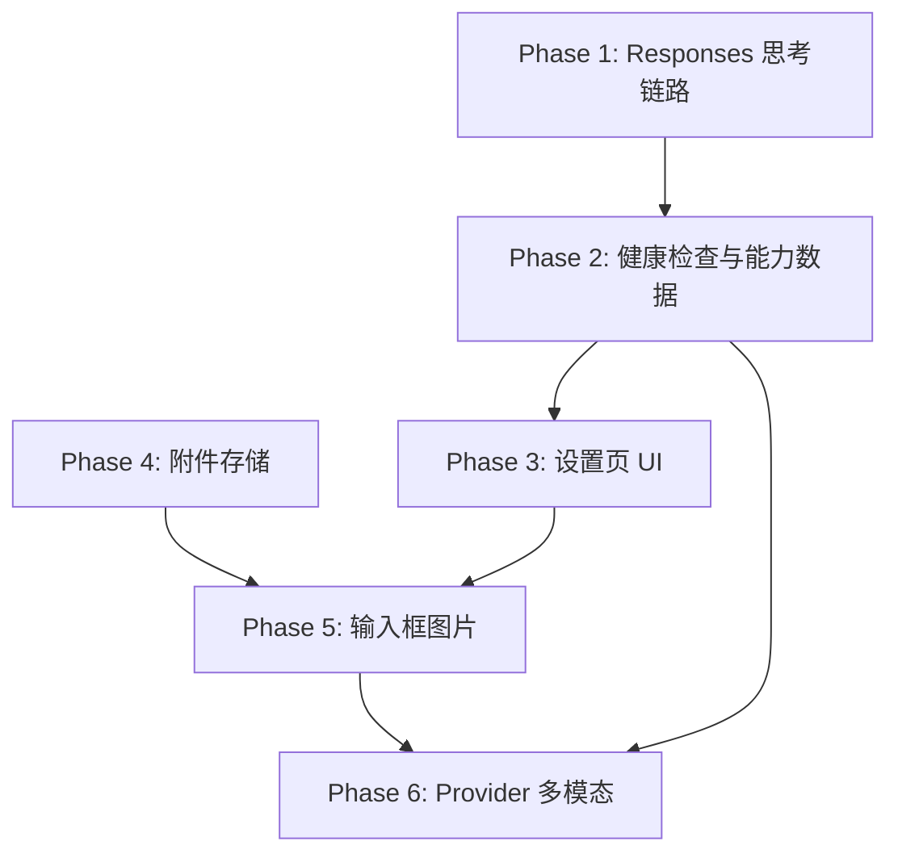

# 模型供应商设置与视觉输入优化总控计划

**Spec:** `docs/superpowers/specs/2026-06-26-model-provider-settings-and-vision-design.md`

**Status:** phase 1 completed

**目标:** 分阶段完成模型 Provider 协议拆分、OpenAI Responses 思考链路修复、模型设置页重构、健康检查、模型能力标签，以及图片上传/粘贴输入。

## 执行原则

- 每次执行只推进一个阶段文档，不跨阶段混改。
- 每个阶段完成后更新本总控文档的状态。
- P0 阶段必须优先完成：OpenAI Responses 思考内容恢复。
- 普通用户 UI 不展示 CCR；CCR 只作为内部实现和日志诊断信息。
- 当前仍处于开发阶段，不做旧 `openai-compatible` 配置迁移。

## 阶段文档

| Phase | 文档 | 状态 | 目标 |
|---|---|---|---|
| 1 | `2026-06-26-model-provider-phase-1-responses-reasoning.md` | completed | 修复 OpenAI Responses 思考链路 |
| 2 | `2026-06-26-model-provider-phase-2-health-capabilities.md` | not started | 连接健康检查与模型能力数据 |
| 3 | `2026-06-26-model-provider-phase-3-settings-ui.md` | not started | 设置页双栏改造与隐藏 CCR |
| 4 | `2026-06-26-model-provider-phase-4-attachments-storage.md` | not started | 图片附件存储与上传 API |
| 5 | `2026-06-26-model-provider-phase-5-composer-images.md` | not started | 输入框上传/粘贴图片与历史展示 |
| 6 | `2026-06-26-model-provider-phase-6-multimodal-provider.md` | not started | Provider 多模态发送与非视觉附件说明 |

## 依赖顺序

## 当前决策记录

- Provider 协议拆分为 `openai-chat-completions`、`openai-responses`、`anthropic`。
- OpenAI Responses 由用户配置显式选择，不用模型名推断。
- Responses 路径需要 CCR `openai-responses` transformer 与 SDK `thinking: { type: "enabled", budgetTokens: 1024, display: "summarized" }`。
- 设置页展示完整上游请求地址，不展示 CCR 本地地址。
- 模型能力标签允许系统探测和用户手动覆盖。
- 不做默认图片识别模型，不做自动切换视觉模型。
- 第一阶段图片输入支持文件选择和剪贴板粘贴，不做拖拽。
- 非视觉模型也允许发送图片附件，通过稳定路径说明让 agent 可用工具读取。

## 跨阶段验证清单

- 自定义 Provider 选择 OpenAI Responses 后，最终请求地址显示 `/responses`。
- sub2api/GPT5.5 通过 Responses 能显示 reasoning/thinking。
- Chat Completions 配置不被强制改成 Responses。
- 设置页普通 UI 不出现 CCR 字样。
- 连接测试能区分认证、网络、协议和模型错误。
- 模型行展示能力标签，且手动覆盖状态可见。
- 上传图片和截图粘贴能持久化并在历史消息展示。
- 视觉模型收到 image block。
- 非视觉模型收到附件路径说明。

## 进度记录

- 2026-06-26: 创建总控计划和阶段计划文档。
- 2026-06-26: Phase 1 已完成。Provider 协议拆分为 Chat Completions / Responses / Anthropic；Responses 路径通过 CCR `openai-responses` transformer 和 SDK summarized thinking 恢复思考内容。
