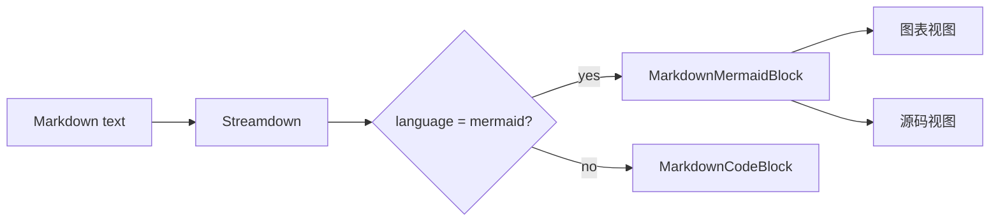

# Mermaid 聊天展示切换设计

日期：2026-06-07

## 目标

让聊天消息和右侧 Markdown 文件预览中的 Mermaid 内容可以直接显示为图表，并允许用户在同一个块内切换「图表」与「源码」两个查看方式。

默认视图为图表。切换控件使用与现有代码块一致的 header 形态：左侧显示 `Mermaid`，右侧显示「图表 / 源码」分段按钮。源码视图展示原始 Mermaid 文本，并保留复制入口。

## 非目标

- 不新增独立的 Mermaid 编辑器。
- 不支持用户修改图表源码并实时回写消息或文件。
- 不新增下载 PNG/SVG/MMD 的功能。
- 不改变非 Mermaid 代码块的展示方式。
- 不修改 sidecar、AGUI runtime 或消息持久化协议。

## 当前状态

项目已经安装并接入：

- `streamdown`
- `@streamdown/cjk`
- `@streamdown/code`
- `@streamdown/math`
- `@streamdown/mermaid`

聊天正文在 `src/features/task/ChatStream.tsx` 中使用 `Streamdown` 渲染，并通过 `STREAMDOWN_COMPONENTS` 把普通代码块覆盖为项目自有 `CodeBlock`。

Markdown 文件预览在 `src/shared/markdown/MarkdownView.tsx` 中使用 `Streamdown` 渲染，也复用 `STREAMDOWN_COMPONENTS`。因此聊天和文件预览可以共享同一个 Mermaid 自定义 renderer。

`streamdown` 类型定义暴露了 `plugins.renderers`：

```ts
interface CustomRendererProps {
  code: string;
  isIncomplete: boolean;
  language: string;
  meta?: string;
}

interface CustomRenderer {
  component: React.ComponentType<CustomRendererProps>;
  language: string | string[];
}
```

这是本功能的推荐切入点，比在 `pre` override 中手动识别 `language-mermaid` 更稳定。

## 推荐方案

新增共享组件 `MarkdownMermaidBlock`，并把它注册到共享 Streamdown plugin 配置：

```ts
const STREAMDOWN_PLUGINS = {
  cjk,
  code,
  math,
  mermaid,
  renderers: [{ language: "mermaid", component: MarkdownMermaidBlock }],
};
```

聊天和 Markdown 预览都使用这份共享 plugin 配置。

组件行为：

1. 接收 `code`、`language`、`isIncomplete`。
2. 默认显示「图表」视图。
3. 点击「源码」后显示项目现有 `CodeBlock`，语言为 `mermaid`，header 内保留复制按钮。
4. Mermaid fence 仍在 streaming 中未闭合时，不立即渲染图表；显示源码视图或轻量提示，避免对不完整 Mermaid 文本反复触发图表渲染。
5. 图表渲染失败时显示错误提示，同时保留源码切换，方便用户检查语法。

## 视觉设计

采用用户确认的 A 方案：

- 外层像代码块一样有边框、圆角和 header。
- header 左侧显示 `Mermaid`。
- header 右侧是「图表 / 源码」分段切换。
- 图表区域使用 token-backed surface：`bg-background`、`border-border`、`text-foreground`、`text-muted-foreground`。
- 不新增原始 hex / HSL；不引入新 design token。

## 文件结构

- `src/shared/markdown/MarkdownMermaidBlock.tsx`
  - 负责 Mermaid 图表/源码切换 UI。
  - 使用 `@streamdown/mermaid` 的 `mermaid.getMermaid()` 渲染 SVG。
  - 源码视图复用 `CodeBlock`。
- `src/shared/markdown/streamdownPlugins.tsx`
  - 统一导出聊天和静态 Markdown 预览共用的 `STREAMDOWN_PLUGINS`。
  - 把 cjk/code/math/mermaid 和 Mermaid custom renderer 组合到一起。
- `src/shared/markdown/MarkdownCodeBlock.tsx`
  - 继续负责普通代码块 `pre` override。
  - 不处理 Mermaid 语言。
- `src/shared/markdown/MarkdownView.tsx`
  - 改为从 `streamdownPlugins.tsx` 导入共享 plugin 配置。
- `src/features/task/ChatStream.tsx`
  - 改为从 `streamdownPlugins.tsx` 导入共享 plugin 配置。
- `src/shared/markdown/MarkdownMermaidBlock.test.tsx`
  - 覆盖默认图表视图、源码切换、incomplete fallback、非 Mermaid 代码块不受影响。

## 数据流

Mermaid fenced code 从 Markdown 文本进入 Streamdown：



聊天和文件预览都只传原始 Markdown 字符串，不需要额外消息 schema 或文件 preview schema。

## 错误处理

- `isIncomplete === true` 时不渲染图表，避免 streaming 过程中 Mermaid 解析半成品。
- Mermaid 渲染失败时显示简短错误文案，并允许用户切换源码。
- 源码视图永远可用，作为兜底检查入口。

## 测试策略

先写失败测试，再实现：

- Mermaid fence 默认显示「图表」视图和切换控件。
- 点击「源码」后展示 Mermaid 源码文本。
- `isIncomplete` 为 true 时不渲染图表。
- 普通 `typescript` fence 仍走现有 `CodeBlock`。

验证命令：

```bash
bun test src/shared/markdown/MarkdownMermaidBlock.test.tsx
bunx tsc --noEmit -p tsconfig.app.json
```

## 自检

- 无 `TBD` / `TODO` / 占位要求。
- 范围只覆盖聊天内容和 Markdown 预览，不触碰运行时协议。
- 设计与用户选择一致：A 形态，B 范围。
- 样式遵循 design token 技能要求，不引入 raw color。
